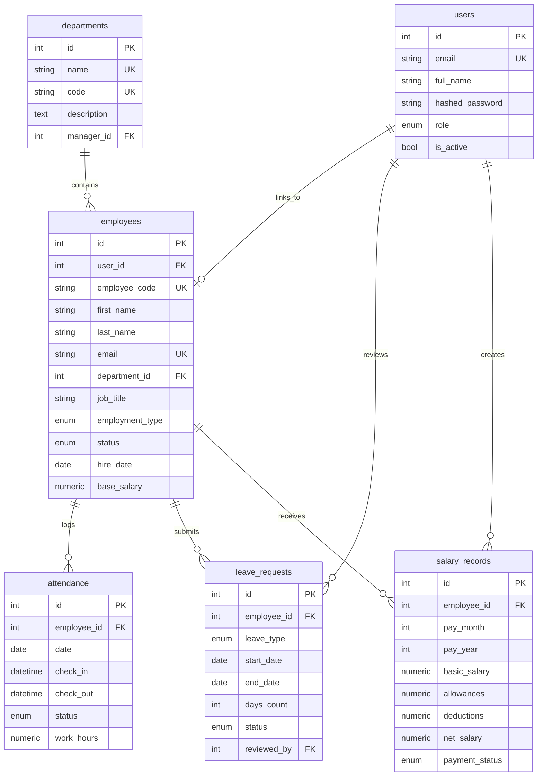

# PeoplePulse EMS — Enterprise Employee Management System

A full-stack, production-style **Employee Management System (EMS)** built with **Python FastAPI**, **PostgreSQL**, **SQLAlchemy 2.0**, **Alembic**, and **React (Vite + Tailwind CSS)**.

---

## 1. Key Features & Role-Based Access Control (RBAC)

### User Roles
| Capability | Admin | HR Manager | Employee |
| :--- | :---: | :---: | :---: |
| User role management (`/users`) | Full | — | — |
| Employee directory CRUD, search, filter, deactivate, delete | Full | Full | Self only |
| Department CRUD & employee assignment | Full | Full | Read directory |
| Daily check-in / check-out & attendance history | All | All | Self only |
| Leave application & cancellation | All | All | Self only |
| Leave approval / rejection | Full | Full | — |
| Salary record creation & updates | Full | Full | — |
| Salary record deletion | Full | — | — |
| View salary records & summaries | All | All | Self only |
| Analytics dashboard | Company-wide | Company-wide | Personal KPIs |

### Security Highlights
- **Argon2id** password hashing via `argon2-cffi` (salted, memory-hard, Python 3.12+ native).
- **JWT Bearer** authentication (`PyJWT`) with expiration and role claims.
- Public `/auth/register` always enforces `employee` role (prevents privilege escalation).
- Strict response schemas (`UserResponse`) never expose `hashed_password`.
- Server-side `net_salary` computation (`basic_salary + allowances - deductions >= 0`).

---

## 2. System Architecture & Folder Structure

```text
employee_mangement/
├── backend/
│   ├── alembic/                 # Database migrations
│   │   └── versions/
│   ├── app/
│   │   ├── core/                # Config, Argon2/JWT security, exception handlers
│   │   ├── dependencies/        # Auth & RBAC FastAPI dependencies
│   │   ├── models/              # SQLAlchemy 2.0 ORM models (6 tables)
│   │   ├── routers/             # REST API routers (/api/v1/*)
│   │   ├── schemas/             # Pydantic v2 validation & response schemas
│   │   ├── services/            # Business logic & pagination layer
│   │   ├── database.py          # Engine & session lifecycle
│   │   ├── main.py              # FastAPI app, CORS, lifespan seeder
│   │   └── seed.py              # Idempotent demo data seeder
│   ├── tests/                   # Pytest integration & RBAC test suite
│   ├── alembic.ini
│   ├── Dockerfile
│   ├── pytest.ini
│   ├── requirements.txt
│   └── .env.example
├── frontend/
│   ├── src/
│   │   ├── components/          # Reusable UI (DataTable, Charts, Modal, ConfirmDialog)
│   │   ├── context/             # AuthContext
│   │   ├── hooks/               # useAuth, useDebounce
│   │   ├── layouts/             # Responsive Sidebar + Header layout
│   │   ├── pages/               # Admin, HR, Employee dashboards & CRUD pages
│   │   └── services/            # Axios client & API modules
│   ├── Dockerfile
│   ├── nginx.conf
│   ├── package.json
│   └── .env.example
├── docker-compose.yml
├── .env.example
└── README.md
```

---

## 3. Database Entity-Relationship Diagram



---

## 4. Quick Start with Docker Compose

1. Copy the root environment template:
   ```bash
   cp .env.example .env
   ```
2. Build and launch PostgreSQL, FastAPI (with Alembic migrations + demo seed), and React:
   ```bash
   docker compose up --build
   ```
3. Access the services:
   - **Frontend App**: http://localhost:3000
   - **Swagger / OpenAPI Docs**: http://localhost:8000/docs
   - **ReDoc**: http://localhost:8000/redoc
   - **Health Check**: http://localhost:8000/health

---

## 5. Local Development Setup (Without Docker)

### Backend
```bash
cd backend
python3 -m venv .venv
source .venv/bin/activate
pip install -r requirements.txt
cp .env.example .env
# Update DATABASE_URL in backend/.env to point to your PostgreSQL database
alembic upgrade head
uvicorn app.main:app --reload --port 8000
```

### Frontend
```bash
cd frontend
npm install
cp .env.example .env
npm run dev
```
The React app runs at http://localhost:5173.

---

## 6. Running Automated Tests

```bash
cd backend
pytest
```
Tests run against an isolated in-memory SQLite database with foreign keys enabled and verify:
- Registration, JWT login, logout, password change, and Admin user role management
- Employee CRUD, search, filters, pagination, deactivation, and deletion
- Department CRUD, employee assignment, and safe-delete conflict protection (`409`)
- Attendance check-in/out, duplicate prevention, hours calculation, and reporting
- Leave application, date & overlap validation, cancellation, and HR/Admin approvals
- Salary calculation (`net_salary`), duplicate pay-period blocking, and strict RBAC privacy
- Role-scoped dashboard analytics

---

## 7. Demo Accounts (Seeded Automatically when `SEED_DEMO_DATA=true`)

| Role | Email | Password |
| :--- | :--- | :--- |
| **Admin** | `admin@company.com` | `Admin@123` |
| **HR Manager** | `hr@company.com` | `HrManager@123` |
| **Employee** | `employee@company.com` | `Employee@123` |

---

## 8. Core REST API Endpoints (`/api/v1`)

- **Auth**: `POST /auth/register`, `POST /auth/login`, `POST /auth/logout`, `GET /auth/me`, `POST /auth/change-password`
- **Users (Admin)**: `GET /users`, `POST /users`, `PATCH /users/{user_id}`
- **Departments**: `GET /departments`, `GET /departments/{id}`, `POST /departments`, `PUT /departments/{id}`, `DELETE /departments/{id}`, `POST /departments/{id}/assign-employees`
- **Employees**: `GET /employees/me`, `PATCH /employees/me`, `GET /employees`, `POST /employees`, `GET /employees/{id}`, `PUT /employees/{id}`, `POST /employees/{id}/deactivate`, `DELETE /employees/{id}`
- **Attendance**: `POST /attendance/check-in`, `POST /attendance/check-out`, `POST /attendance`, `GET /attendance`, `GET /attendance/report`
- **Leaves**: `POST /leaves`, `GET /leaves`, `PATCH /leaves/{id}/review`, `POST /leaves/{id}/cancel`
- **Salaries**: `GET /salaries/summary`, `GET /salaries`, `POST /salaries`, `PUT /salaries/{id}`, `DELETE /salaries/{id}`
- **Dashboard**: `GET /dashboard/overview`
