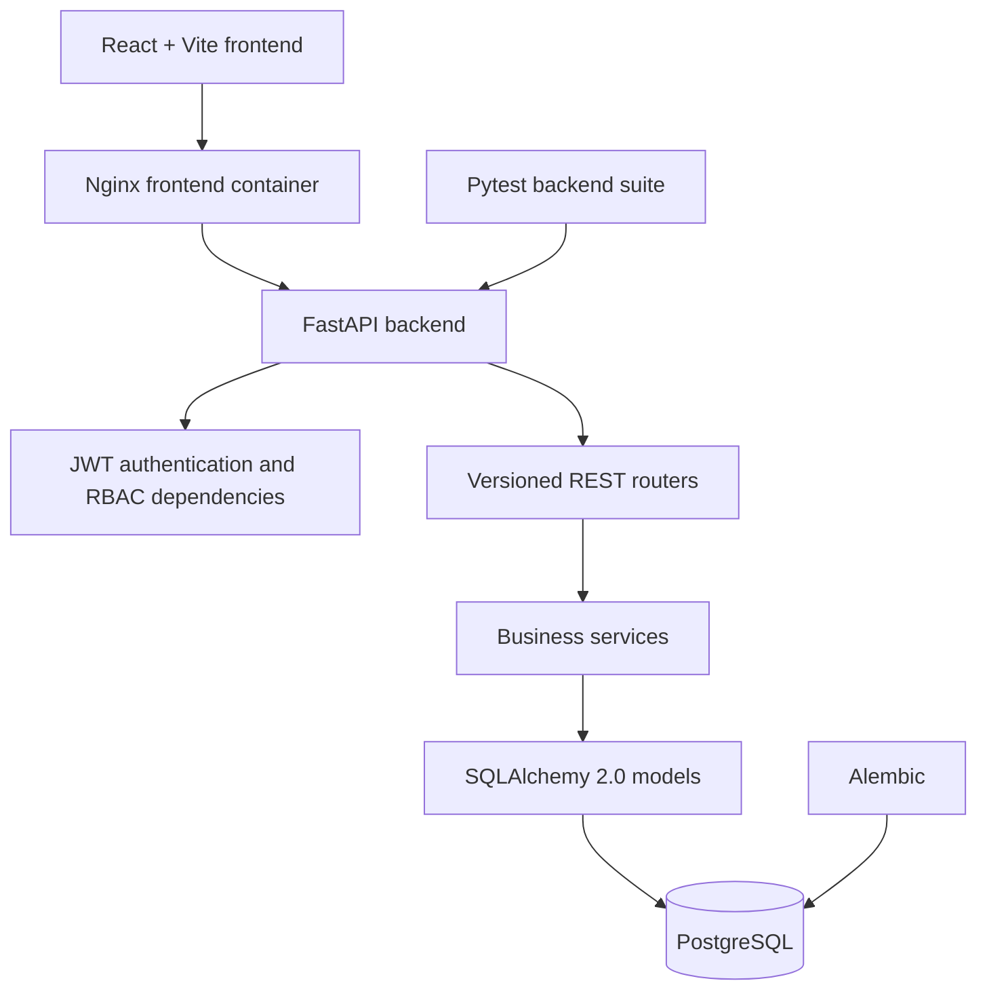

# PeoplePulse EMS — System Architecture

The React client calls the FastAPI API. Authentication and role-based dependencies protect administrative, HR, and employee workflows. Services implement business rules; SQLAlchemy persists records; Alembic manages schema revisions.
