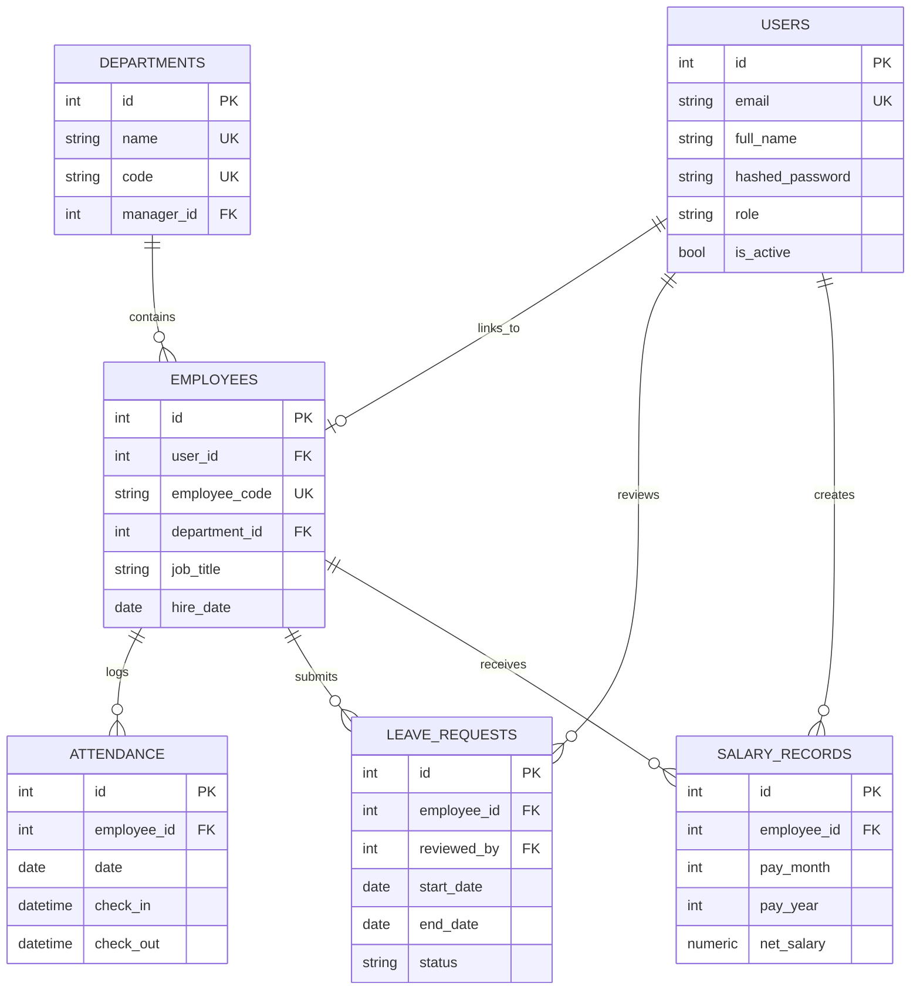

# PeoplePulse EMS — Database ER Diagram

This diagram follows the entities and relationships documented in the repository README. Verify exact column names, enum values, and constraints against `backend/app/models/` and Alembic revisions before using it as a migration specification.
